# GlobalSolutionCitizenTech

Backend das **quadras inteligentes contra alagamentos**: uma API REST que recebe leituras de sensores
urbanos, consulta a previsão de chuva, calcula o risco de alagamento por bairro e age sozinha:
**despacha robôs para desentupir bocas de lobo**, prepara quadras públicas para virarem reservatórios
temporários e emite alertas para a Defesa Civil.

Projeto da Global Solution, disciplina **Arquitetura Orientada a Serviços (SOA) e Web Services**.

## Integrantes

| Nome | RM |
| --- | --- |
| Ana Clara Melo de Sousa |  RM 559021 |
| Yasmin Gonçalves Coelho | RM 559147 |
| David Murillo de Oliveira Soares | RM 559078 |
| Lucas Serrano | RM555170 |


---

## O problema

Boa parte dos alagamentos urbanos não vem de chuva acima da capacidade da rede, e sim de **drenagem
entupida** e de **resposta tardia**: a limpeza e o alerta acontecem depois que a rua já alagou. Os
piscinões convencionais são obras grandes, caras e ociosas na maior parte do ano.

## A solução

A cidade passa a agir **antes** da chuva, num ciclo de três etapas:

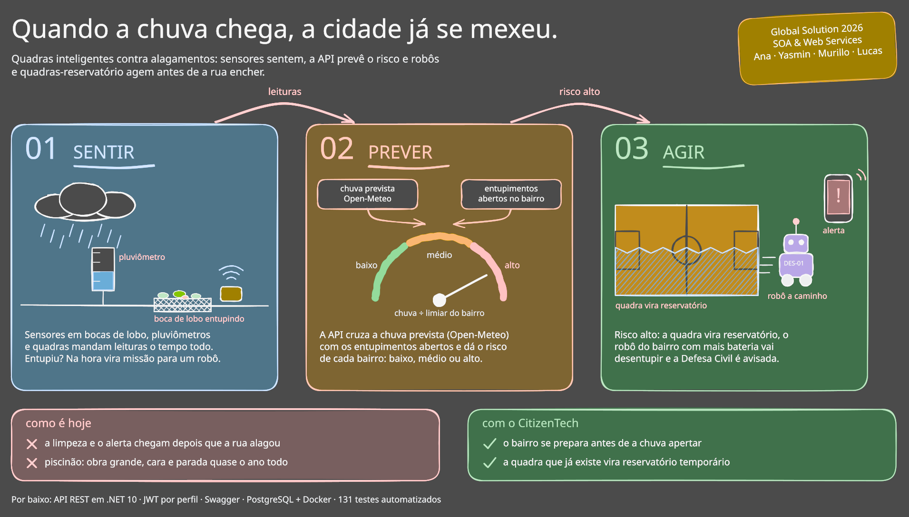

Diagrama editável: [`docs/solucao.excalidraw`](docs/solucao.excalidraw).

| Etapa | O que a API faz |
| --- | --- |
| **Sentir** | Recebe leituras dos sensores. Boca de lobo acima do limiar abre uma missão de desobstrução e despacha o robô mais adequado. |
| **Prever** | Consulta a chuva prevista no Open-Meteo, soma os entupimentos abertos e classifica o risco do bairro (baixo, médio ou alto). |
| **Agir** | Com risco alto, as quadras do bairro entram em preparação, as missões viram prioridade alta e um alerta é emitido. A quadra que recebe água passa a reter; perto da capacidade, gera alerta. |

---

## Arquitetura

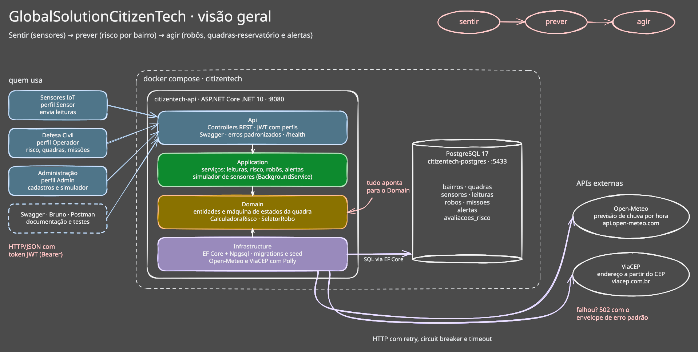

Os consumidores falam com a API por HTTP/JSON, sempre com um token JWT cujo **perfil** define o que
cada um pode fazer. A API e o PostgreSQL rodam em containers do Docker Compose. A camada de
infraestrutura é a única que conhece o banco e as APIs externas.

Diagrama editável: [`docs/arquitetura.excalidraw`](docs/arquitetura.excalidraw).

### Arquitetura de serviços

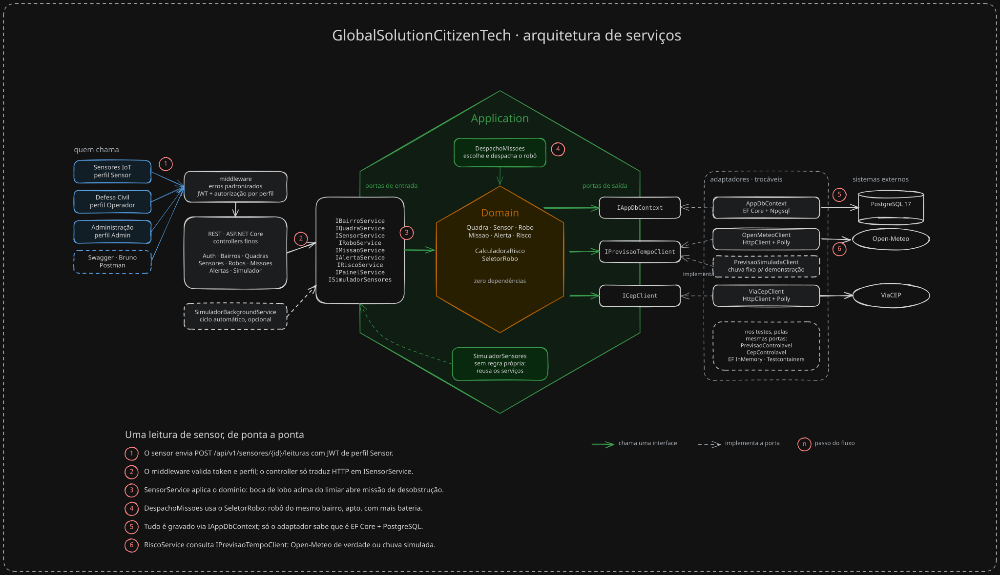

Portas e adaptadores: o hexágono é o núcleo (Application em volta do Domain) e não conhece HTTP,
banco nem API externa. À esquerda, quem chama entra pelas portas de entrada (interfaces dos
serviços); à direita, os adaptadores implementam as portas de saída (`IAppDbContext`,
`IPrevisaoTempoClient`, `ICepClient`). Por isso a previsão real e a simulada, e os fakes dos
testes, entram sem mudar nenhum serviço. Os números em vermelho seguem uma leitura de sensor de
ponta a ponta.

Diagrama editável: [`docs/arquitetura-servicos.excalidraw`](docs/arquitetura-servicos.excalidraw),
que abre em [excalidraw.com](https://excalidraw.com) pelo menu *Abrir*.

---

## Como executar

### Opção 1: Docker (recomendado)

Pré-requisito: Docker Desktop.

```bash
docker compose up -d --build
```

| O quê | Endereço |
| --- | --- |
| Swagger (documentação interativa, só em Development) | http://localhost:8081/swagger |
| API | http://localhost:8081/api/v1 |
| Health check (API + banco) | http://localhost:8081/health |
| PostgreSQL | `localhost:5434` · banco, usuário e senha `citizentech` |

Na subida, a API aplica as migrations e popula o banco com dados de demonstração (2 bairros reais de
São Paulo, 4 quadras, 6 sensores e 4 robôs fictícios). Para recomeçar do zero:

```bash
docker compose down -v
```

### Usando a API no Swagger

Todos os endpoints, exceto `POST /api/v1/auth/token` e `/health`, exigem token.

1. Em `POST /api/v1/auth/token`, envie um dos clientes de demonstração abaixo.
2. Copie o `accessToken` da resposta.
3. Clique em **Authorize** (cadeado) e cole o token.

| `clientId` | `clientSecret` | Perfil |
| --- | --- | --- |
| `admin` | `admin-demo-2026` | Admin |
| `defesa-civil` | `defesa-civil-demo-2026` | Operador |
| `sensor-gateway` | `sensor-gateway-demo-2026` | Sensor |

> Credenciais e chave JWT de **demonstração**, definidas em `appsettings.Development.json`. Em
> produção, viriam de variáveis de ambiente ou de um cofre de segredos.

### Simulador: a cidade em funcionamento

O simulador gera leituras para todos os sensores a cada ciclo, conclui as missões dos robôs, recarrega
os robôs sem bateria e reavalia o risco dos bairros. Para ligá-lo em background num cenário de temporal,
com previsão fixa de 35 mm (o que força risco alto):

```bash
SIMULADOR=true CENARIO=ChuvaForte CHUVA_PREVISTA_MM=35 docker compose up -d
```

```bash
docker logs -f citizentech-api
```

| Variável | Padrão | O que faz |
| --- | --- | --- |
| `SIMULADOR` | `false` | Liga o ciclo automático |
| `CENARIO` | `Normal` | `Normal` (tempo seco) ou `ChuvaForte` (temporal) |
| `INTERVALO_SIMULADOR` | `20` | Segundos entre ciclos |
| `CHUVA_PREVISTA_MM` | vazio | Previsão fixa no lugar do Open-Meteo |

Mesmo com o simulador desligado, um ciclo pode ser disparado manualmente em `POST /api/v1/simulador/ciclo`
(perfil Admin).

### Opção 2: .NET local

Pré-requisitos: .NET SDK 10 e Docker (só para o PostgreSQL).

```bash
docker compose up -d postgres
```

```bash
dotnet run --project src/GlobalSolutionCitizenTech.Api
```

A API sobe em http://localhost:5080/swagger.

### Testes

Os testes de integração sobem um PostgreSQL próprio com Testcontainers, então o Docker precisa estar
rodando.

```bash
dotnet test
```

Com relatório de cobertura:

```bash
dotnet tool restore
```

```bash
dotnet test --collect:"XPlat Code Coverage" --results-directory TestResults
```

```bash
dotnet reportgenerator -reports:"TestResults/*/coverage.cobertura.xml" -targetdir:docs/evidencias/cobertura -reporttypes:"Html;TextSummary" -classfilters:"-*.Migrations.*;-*Program*"
```

---

## Camadas

Arquitetura em camadas: o domínio não conhece banco nem HTTP, e as dependências apontam para dentro.

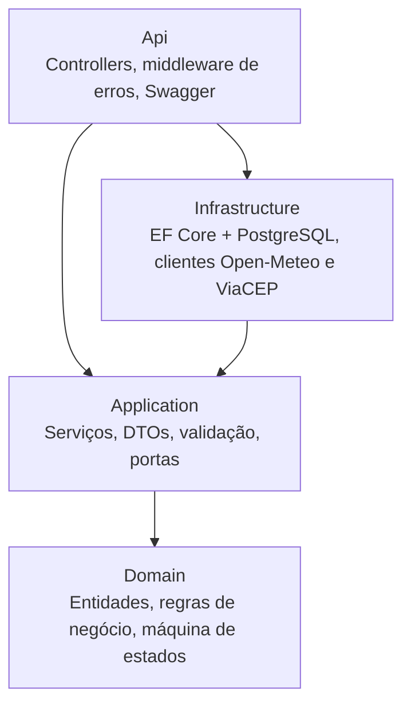

| Camada | Responsabilidade |
| --- | --- |
| `Domain` | Entidades com comportamento (`Quadra`, `Sensor`, `Robo`, `Missao`...), a máquina de estados da quadra, o cálculo de risco e a escolha do robô. Sem dependências externas. |
| `Application` | Casos de uso (serviços), DTOs com validação, exceções de aplicação, o simulador e as **portas** `IAppDbContext`, `IPrevisaoTempoClient` e `ICepClient`. |
| `Infrastructure` | Adaptadores: `AppDbContext` (EF Core + Npgsql, migrations), `OpenMeteoClient` e `ViaCepClient` com resiliência (retry, circuit breaker e timeout). |
| `Api` | Controllers REST, autenticação JWT por perfil, envelope único de erro, Swagger, health check, ciclo do simulador em background e inicialização do banco. |

### Stack

| Item | Tecnologia |
| --- | --- |
| Runtime | .NET 10 / ASP.NET Core |
| Banco | PostgreSQL 17 + Entity Framework Core 10 (Npgsql), migrations, nomes em snake_case |
| APIs externas | [Open-Meteo](https://open-meteo.com/) (previsão de chuva) e [ViaCEP](https://viacep.com.br/) (endereço por CEP) |
| Resiliência | `Microsoft.Extensions.Http.Resilience` (Polly) |
| Segurança | JWT Bearer (HMAC-SHA256) com autorização por perfil |
| Documentação | Swagger / OpenAPI (Swashbuckle) com comentários XML |
| Testes | xUnit, EF Core InMemory, `WebApplicationFactory`, Testcontainers, coverlet + ReportGenerator |
| Containers | Docker e Docker Compose |

### Modelo de dados

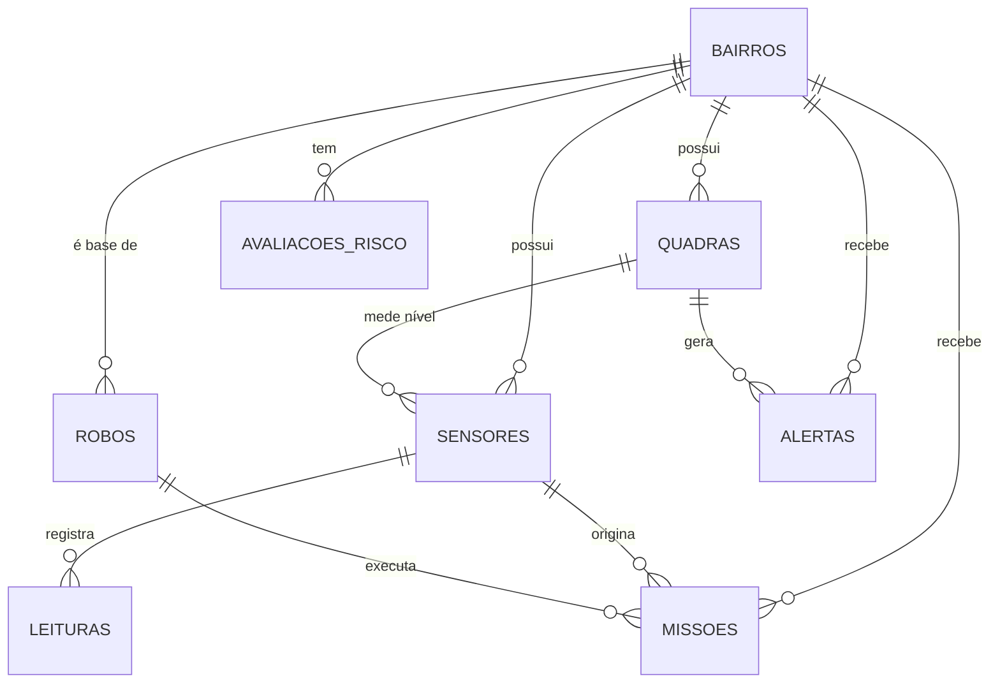

---

## Regras de negócio

1. **Entupimento.** Leitura de boca de lobo igual ou acima do limiar abre uma missão de desobstrução,
   sem duplicar se já houver uma aberta para o mesmo sensor. A missão nasce com prioridade alta se a
   última avaliação de risco do bairro for alta.
2. **Escolha do robô.** O robô precisa ser do mesmo bairro, do tipo certo (desentupidor ou inspetor),
   estar disponível e ter pelo menos 30% de bateria. Entre os aptos, vence o de maior bateria. Sem robô
   apto, a missão fica pendente.
3. **Conclusão da missão.** O robô gasta 15% de bateria, volta a ficar disponível e já assume a missão
   pendente mais prioritária do bairro. Um robô recém-cadastrado ou recarregado também assume missões
   pendentes.
4. **Risco de alagamento.** Chuva prevista ≥ limiar do bairro é risco **alto**; ≥ 50% do limiar é
   **médio**; abaixo disso, **baixo**. Dois ou mais entupimentos abertos agravam o risco em um nível.
5. **Risco alto.** As quadras disponíveis do bairro vão para `EmPreparacao`, as missões abertas viram
   prioridade alta e um alerta alto é emitido. Risco médio emite alerta médio. Alertas não se repetem
   enquanto houver um ativo de nível igual ou maior.
6. **Ciclo da quadra.** Só as transições abaixo são aceitas; qualquer outra devolve `409`.

   ```mermaid
   stateDiagram-v2
       [*] --> Disponivel
       Disponivel --> EmPreparacao
       Disponivel --> Manutencao
       EmPreparacao --> Retendo: sensor detecta água
       EmPreparacao --> Disponivel: alarme cancelado
       Retendo --> Esvaziando
       Esvaziando --> Disponivel
       Manutencao --> Disponivel
   ```

7. **Nível da quadra.** Uma quadra em preparação que começa a receber água passa a `Retendo`
   automaticamente. A partir de 90% da capacidade, é emitido um alerta.

---

## Endpoints

Documentação completa e interativa no **Swagger** (`/swagger`). O contrato OpenAPI também está em
[`docs/openapi.json`](docs/openapi.json).

**Documentação pública (só leitura):** [`docs/index.html`](docs/index.html) é um Swagger UI estático que
lê o `openapi.json`, sem precisar da API no ar, e com o "Try it out" desligado. Para publicar pelo
GitHub Pages: no repositório, vá em *Settings → Pages*, escolha *Deploy from a branch*, a branch
principal e a pasta `/docs`. A página fica em `https://<usuario>.github.io/<repositorio>/`. Depois de
mudar a API, atualize o contrato:

```bash
curl -s http://localhost:8081/swagger/v1/swagger.json -o docs/openapi.json
```

| Método | Rota (`/api/v1/...`) | Descrição | Acesso |
| --- | --- | --- | --- |
| `POST` | `auth/token` | Troca credenciais por um token JWT | público |
| `GET` | `bairros` | Lista os bairros | Leitura |
| `GET` | `bairros/{id}` | Obtém um bairro | Leitura |
| `POST` | `bairros` | Cadastra um bairro | Cadastro |
| `PUT` | `bairros/{id}` | Atualiza um bairro | Cadastro |
| `DELETE` | `bairros/{id}` | Remove um bairro sem vínculos | Cadastro |
| `POST` | `bairros/{id}/avaliar-risco?horas=6` | Avalia o risco (Open-Meteo) e executa as ações | Operação |
| `GET` | `bairros/{id}/avaliacoes-risco` | Histórico de avaliações | Leitura |
| `GET` | `bairros/{id}/painel` | Painel consolidado para a Defesa Civil | Leitura |
| `GET` | `quadras?bairroId=&status=` | Lista as quadras | Leitura |
| `GET` | `quadras/{id}` | Obtém uma quadra e os próximos status permitidos | Leitura |
| `POST` | `quadras` | Cadastra uma quadra (logradouro via ViaCEP) | Cadastro |
| `PUT` | `quadras/{id}` | Atualiza nome, número e capacidade | Cadastro |
| `PATCH` | `quadras/{id}/status` | Altera o status seguindo a máquina de estados | Operação |
| `DELETE` | `quadras/{id}` | Remove uma quadra fora de operação | Cadastro |
| `GET` | `sensores?bairroId=&tipo=` | Lista os sensores | Leitura |
| `GET` | `sensores/{id}` | Obtém um sensor com a última leitura | Leitura |
| `POST` | `sensores` | Cadastra um sensor | Cadastro |
| `PATCH` | `sensores/{id}/ativacao` | Ativa ou desativa um sensor | Operação |
| `POST` | `sensores/{id}/leituras` | Registra uma leitura e devolve as ações executadas | Envio de leitura |
| `GET` | `sensores/{id}/leituras?pagina=&tamanhoPagina=` | Histórico paginado de leituras | Leitura |
| `GET` | `robos?bairroId=&status=` | Lista os robôs | Leitura |
| `GET` | `robos/{id}` | Obtém um robô | Leitura |
| `POST` | `robos` | Cadastra um robô | Cadastro |
| `POST` | `robos/{id}/recarregar` | Recarrega a bateria | Operação |
| `POST` | `robos/{id}/manutencao` | Envia para manutenção | Operação |
| `DELETE` | `robos/{id}` | Remove um robô sem histórico | Cadastro |
| `GET` | `missoes?status=&bairroId=` | Fila de missões por prioridade | Leitura |
| `GET` | `missoes/{id}` | Obtém uma missão | Leitura |
| `POST` | `missoes` | Abre uma missão manual e despacha um robô | Operação |
| `PATCH` | `missoes/{id}/concluir` | Conclui a missão; o robô assume a próxima | Operação |
| `GET` | `alertas?bairroId=&ativo=` | Lista os alertas | Leitura |
| `PATCH` | `alertas/{id}/encerrar` | Encerra um alerta | Operação |
| `GET` | `simulador` | Configuração e estado do simulador | Cadastro |
| `POST` | `simulador/ciclo` | Executa um ciclo de simulação agora | Cadastro |

Quem tem cada acesso:

| Acesso | Perfis |
| --- | --- |
| Leitura | Operador, Admin |
| Operação | Operador, Admin |
| Envio de leitura | Sensor, Admin |
| Cadastro | Admin |

### Erros

Todo erro sai no mesmo envelope:

```json
{
  "success": false,
  "errorCode": "BUSINESS_RULE_VIOLATION",
  "message": "A operação viola uma regra de negócio.",
  "details": "Transição de status inválida para a quadra 'Quadra Poliesportiva Pantanal': Disponivel → Esvaziando.",
  "traceId": "0HNPV6ULA3HIS:00000001"
}
```

| HTTP | `errorCode` | Quando |
| --- | --- | --- |
| 400 | `VALIDATION_ERROR` | Payload inválido (com erros por campo) ou CEP inexistente |
| 401 | `UNAUTHORIZED_ACCESS` | Token ausente, inválido ou expirado, ou credenciais erradas em `auth/token` |
| 403 | `FORBIDDEN` | O perfil do token não pode fazer a operação |
| 404 | `RESOURCE_NOT_FOUND` | Recurso inexistente |
| 409 | `BUSINESS_RULE_VIOLATION` | Regra de negócio violada (transição inválida, código duplicado, recurso em uso) |
| 409 | `DUPLICATE_RECORD` | Violação de unicidade no banco |
| 502 | `EXTERNAL_API_ERROR` | Open-Meteo ou ViaCEP indisponível |
| 500 | `INTERNAL_SERVER_ERROR` | Erro inesperado |

---

## Evidências

| Evidência | Onde |
| --- | --- |
| Cenário completo de chuva forte na API, com requisições e respostas reais | [`docs/evidencias/cenario-api.md`](docs/evidencias/cenario-api.md) |
| Resultado dos 131 testes automatizados e cobertura (92,9% das linhas) | [`docs/evidencias/testes.md`](docs/evidencias/testes.md) |
| Relatório de cobertura por classe e linha | `docs/evidencias/cobertura/index.html` |
| Coleção do Postman (cenário + cadastros + erros, com asserções) | [`docs/postman/GlobalSolutionCitizenTech.postman_collection.json`](docs/postman/GlobalSolutionCitizenTech.postman_collection.json) |
| Collection do Bruno (mesmos fluxos): abra a pasta no Bruno, escolha o ambiente `Local` e rode na ordem | [`docs/bruno/GlobalSolutionCitizenTech`](docs/bruno/GlobalSolutionCitizenTech) |
| Contrato OpenAPI | [`docs/openapi.json`](docs/openapi.json) |
| Prints do Swagger e da execução no Bruno | [Testes no Bruno API](#testes-no-bruno-api), abaixo |

Para regerar o cenário com o banco limpo:

```bash
docker compose down -v && docker compose up -d --build
```

```bash
./scripts/gerar-evidencias.sh
```

### Testes no Bruno API

Execução da [collection do Bruno](docs/bruno/GlobalSolutionCitizenTech) contra a API em Docker, com o banco populado pelo seed.

#### Documentação e saúde

**Swagger com todos os endpoints documentados**

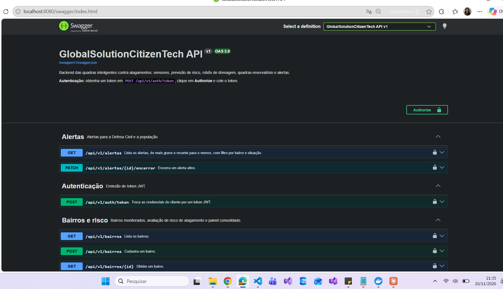

**Health check: API e PostgreSQL no ar**

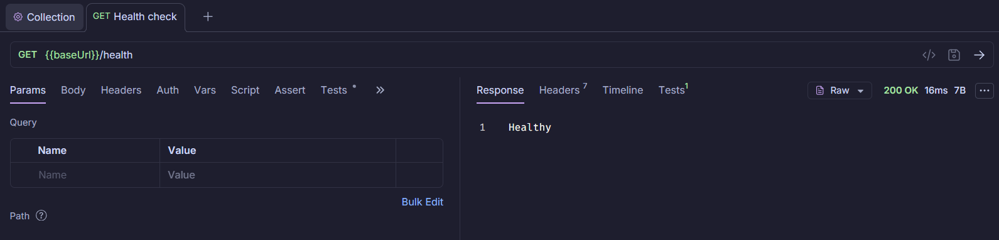

#### Autenticação e segurança

**Token JWT emitido para o perfil Admin**

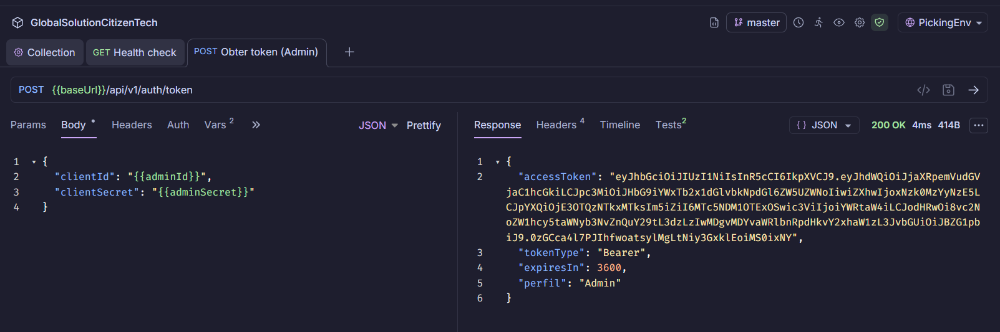

**Credenciais inválidas: 401**

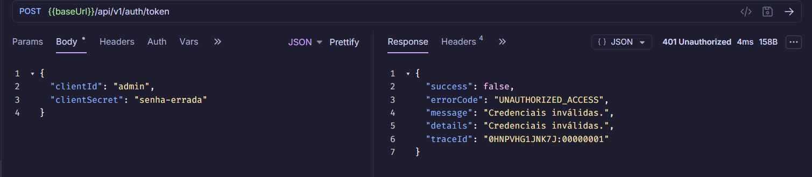

**Requisição sem token: 401 `UNAUTHORIZED_ACCESS`**

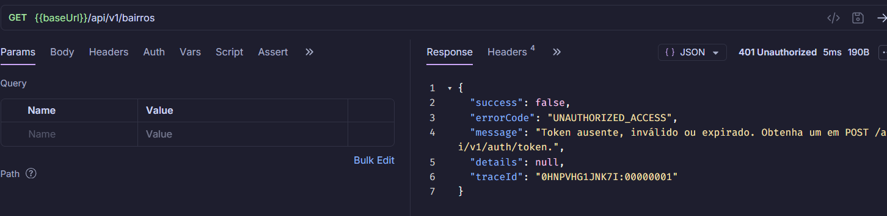

**Perfil Sensor tentando cadastrar bairro: 403 `FORBIDDEN`**

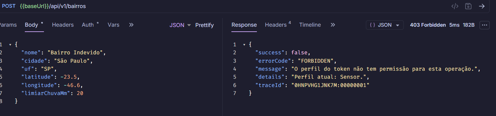

#### Consultas

**Bairros cadastrados**

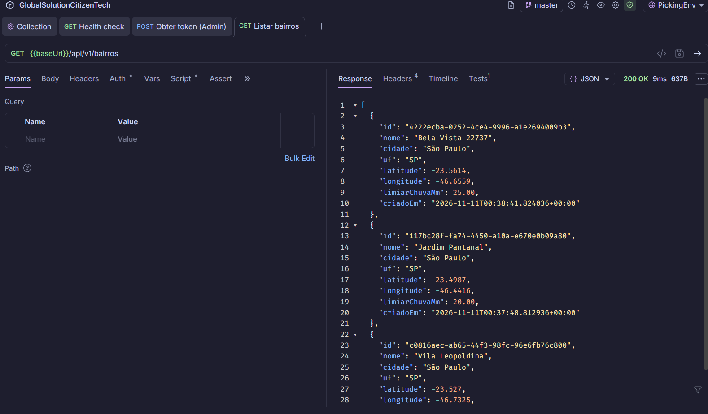

**Sensores do bairro**

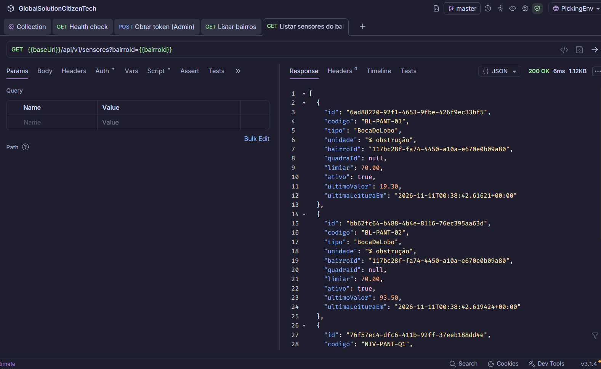

**Quadras do bairro, com os próximos status permitidos**

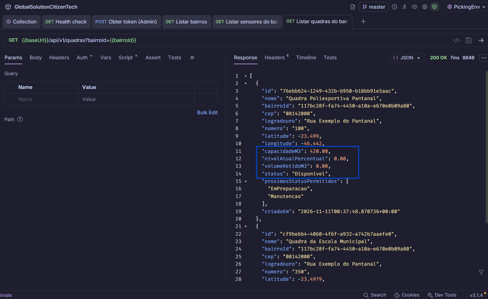

**Robôs do bairro, com status e bateria**

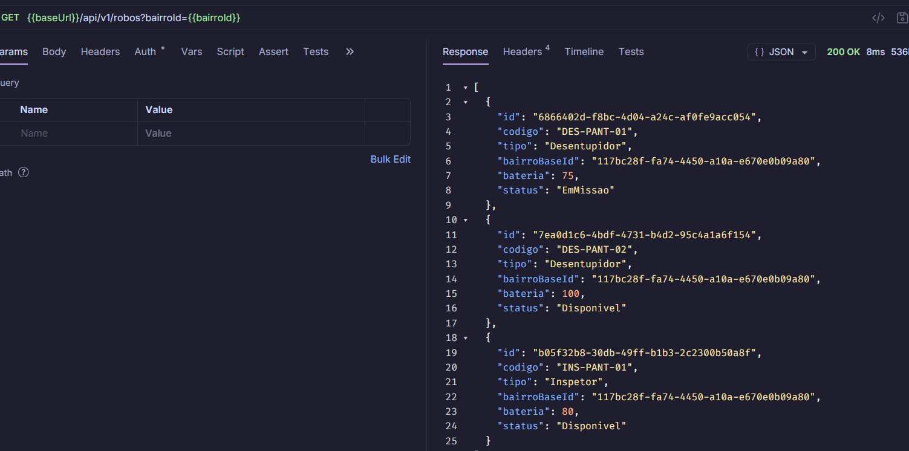

#### Cenário de chuva forte: sentir, prever e agir

**1. Boca de lobo com 85% de obstrução: missão criada e robô despachado**

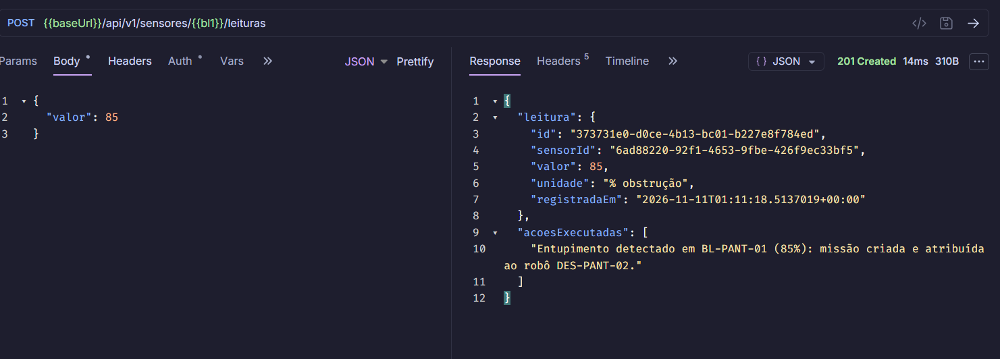

**2. Quadra entra em preparação para receber água**

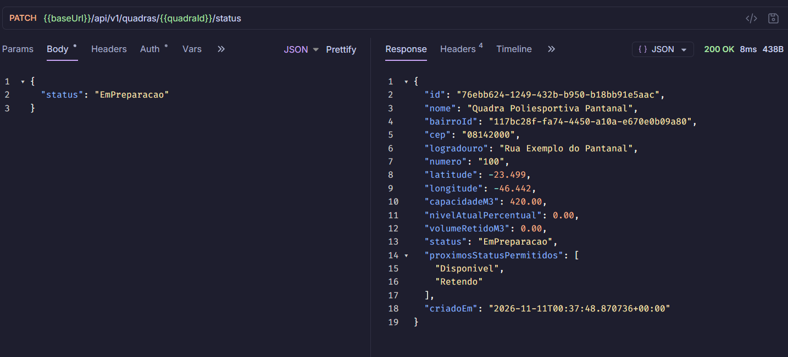

**3. Sensor de nível em 93%: a quadra passa de `EmPreparacao` para `Retendo`**

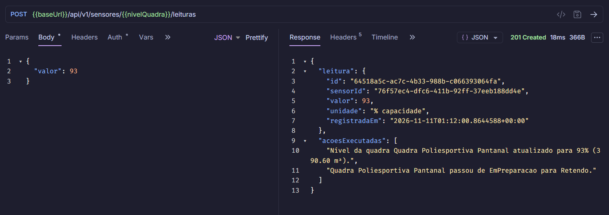

**4. Alertas do bairro**

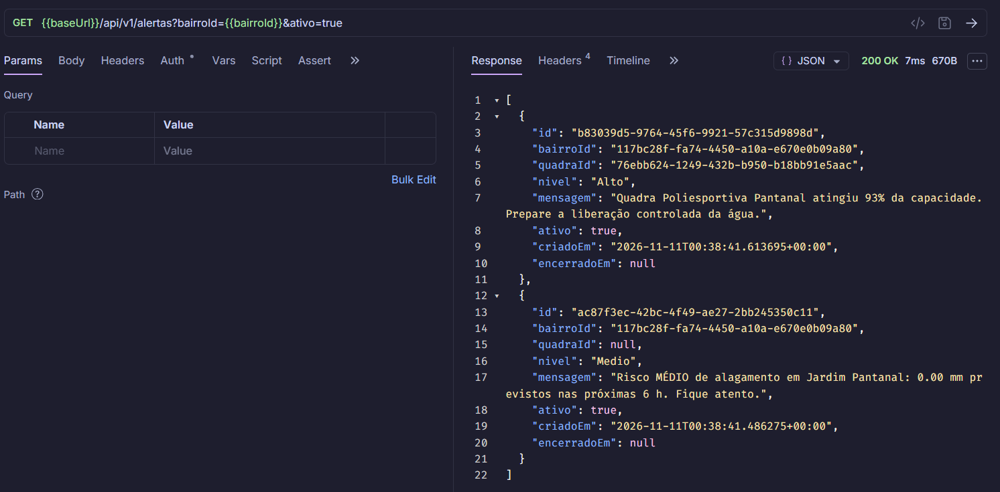

**5. Depois do pico: a quadra libera a água devagar**

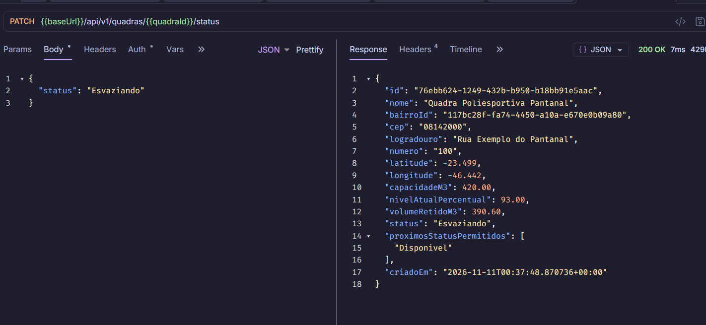

**6. Quadra volta ao uso esportivo**

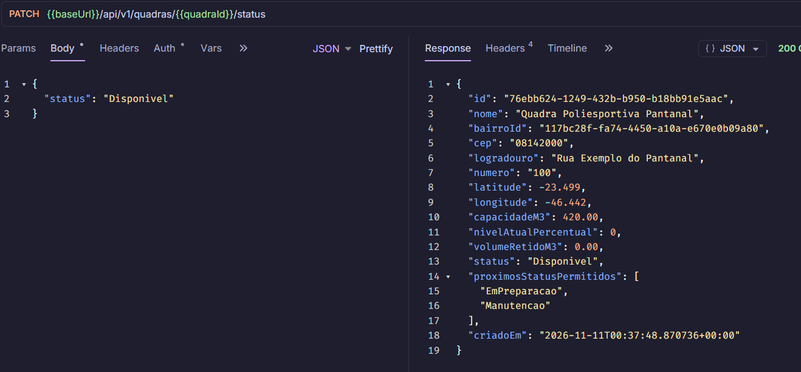

**7. Painel consolidado do bairro para a Defesa Civil**

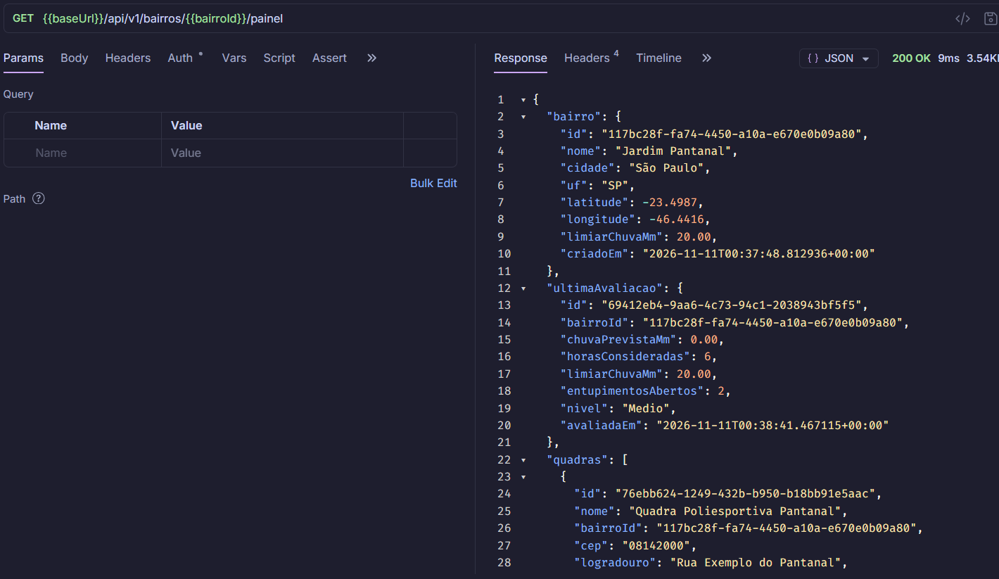

#### Cadastros e erros

**Cadastro de sensor: 201**

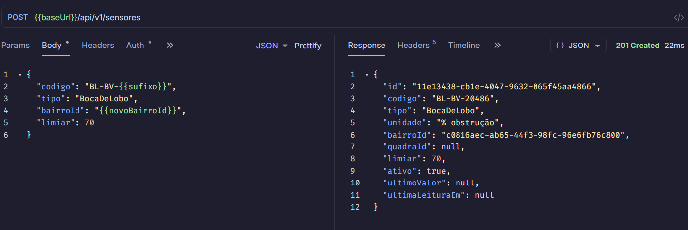

**Payload inválido: 400 com os erros por campo**

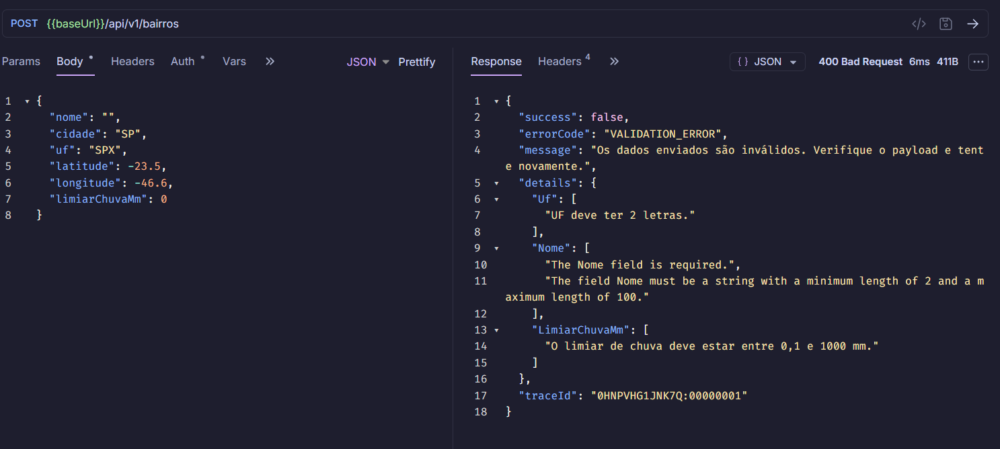

**Quadra com CEP inexistente no ViaCEP: 400**

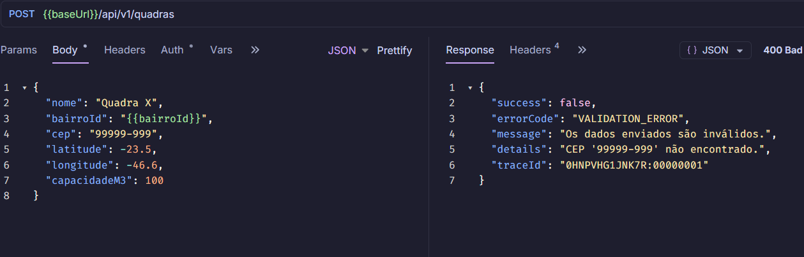

**Robô inexistente: 404 `RESOURCE_NOT_FOUND`**

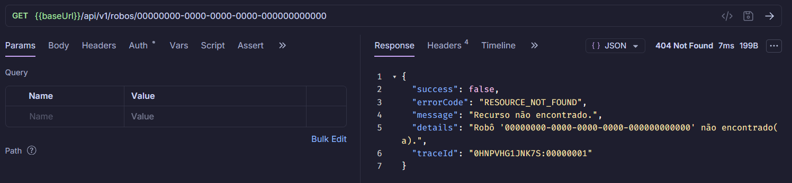


---

## Cyber: dados pessoais, taint analysis e Risco Cidadão

O cadastro de **moradores vulneráveis** (quem precisa de prioridade na evacuação: acamados, quem depende de
oxigênio, quem faz hemodiálise) carrega o dado mais sensível do sistema. O módulo
`GlobalSolutionCitizenTech.Privacidade` protege esse dado em três camadas:

1. **Motor de PII.** Regex + validação (dígito do CPF) sobre todo JSON, formulário e query string. CPF, RG,
   cartão SUS, saúde, senha, token, telefone e e-mail são tagueados e mascarados (`***.456.***-09`). No banco o
   CPF vira máscara + HMAC, e telefone e saúde são cifrados com AES-256-GCM.
2. **Taint analysis.** O que entra como PII fica marcado durante a requisição. Todo log passa por uma barreira
   que suprime saúde e senha e mascara documento e contato. Toda resposta passa por outra, que mascara o dado
   para quem está autenticado e devolve `403 SENSITIVE_DATA_BLOCKED` para quem não está.
3. **Tradução via IA.** Cada detecção vira um evento que o **Claude** traduz em 2 frases para um cidadão leigo
   de 60 anos. O painel mostra o farol (verde, amarelo e vermelho) e o indicador **Risco Cidadão** (0 a 100). O farol é regra fixa;
   a IA só escreve o texto, nunca recebe dado pessoal e tem texto offline de contingência.

| Item | Onde |
| --- | --- |
| Painel | `http://localhost:8081/painel/` |
| Documentação dos 3 pontos (PDF) | [`docs/cyber/GlobalSolution-cyber.pdf`](docs/cyber/GlobalSolution-cyber.pdf) |
| Auditoria (regras, evidências, decisões) | [`docs/cyber/auditoria.md`](docs/cyber/auditoria.md) |
| Endurecimento para rodar exposta (rate limit, cabeçalhos, CSP, teto de corpo, proxy confiável) | [`auditoria.md`, seção 8](docs/cyber/auditoria.md#8-endurecimento-da-api-para-rodar-exposta) |
| Respostas HTTP, log e banco capturados | [`docs/cyber/evidencias/`](docs/cyber/evidencias) |
| Vídeo e prints do painel | `docs/cyber/evidencias/dashboard.webm`, `painel-*.png` |
| Demonstração / gravação / ZIP | `scripts/demo-cyber.sh`, `scripts/gravar-painel.py`, `scripts/empacotar-cyber.py` |

```bash
ANTHROPIC_API_KEY=sk-ant-... docker compose up -d --build   # sem a chave, o painel usa os textos offline
./scripts/demo-cyber.sh
```

---

## Estrutura do repositório

```
├── src/
│   ├── GlobalSolutionCitizenTech.Domain/          entidades, enums, regras (CalculadoraRisco, SeletorRobo)
│   ├── GlobalSolutionCitizenTech.Application/     serviços, DTOs, portas, exceções
│   ├── GlobalSolutionCitizenTech.Infrastructure/  EF Core, migrations, seed, clientes HTTP
│   └── GlobalSolutionCitizenTech.Api/             controllers, middleware de erros, Program.cs
├── tests/
│   ├── GlobalSolutionCitizenTech.UnitTests/         domínio, serviços e clientes
│   └── GlobalSolutionCitizenTech.IntegrationTests/  API + PostgreSQL real (Testcontainers)
├── docs/                                          evidências, Postman, OpenAPI
├── scripts/gerar-evidencias.sh
├── Dockerfile
└── docker-compose.yml
```
